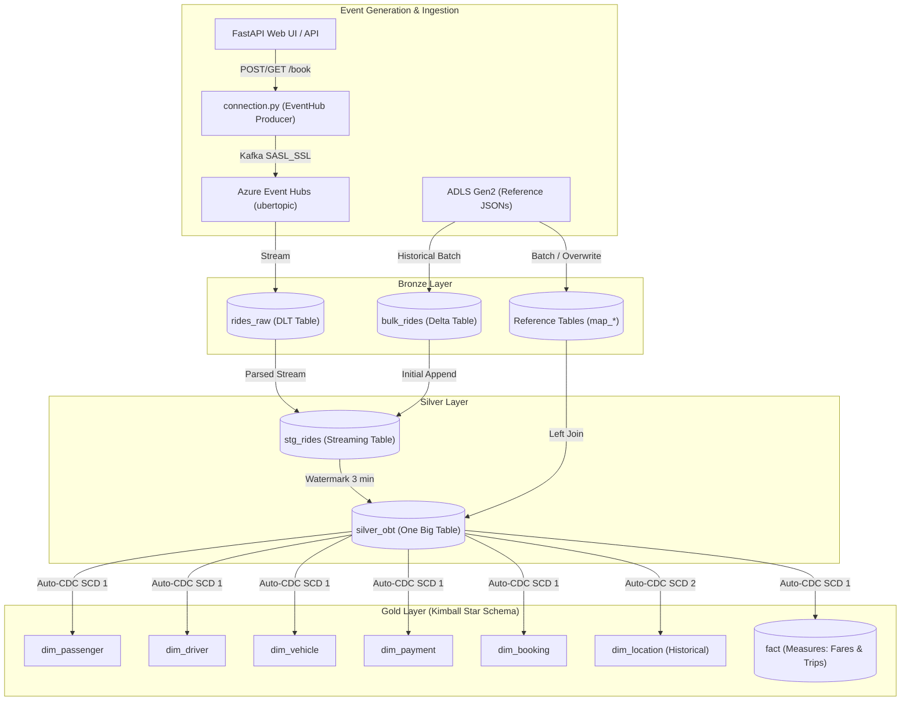

# Real-Time Uber Lakehouse Data Engineering Project

An end-to-end, production-grade real-time streaming data pipeline and lakehouse architecture for ride-sharing event processing. Built using **FastAPI**, **Azure Event Hubs (Kafka API)**, **Azure Data Lake Storage (ADLS Gen2)**, and **Azure Databricks Delta Live Tables (DLT)** implementing the **Medallion Architecture (Bronze &rarr; Silver &rarr; Gold)** with Dimensional Modeling and Slowly Changing Dimensions (SCD Type 1 &amp; Type 2).

---

## Architecture Diagram


---

## Highlights & Key Engineering Concepts

- **Real-Time Streaming Ingestion**: Simulates ride bookings with realistic customer, driver, vehicle, and route metrics using Faker, streaming events asynchronously to Azure Event Hubs over Kafka SASL_SSL.
- **Medallion Lakehouse Architecture**:
  - **Bronze**: Captures raw streaming payloads from Event Hub (`rides_raw`) and batch loads reference dimension mappings (`map_*`).
  - **Silver (Staging & OBT)**: Implements dual append-flow ingestion (historical bulk load + real-time streaming parse) into `stg_rides`, followed by a 3-minute watermarked stream join creating One Big Table (`silver_obt`).
  - **Gold (Star Schema & CDC)**: Employs Delta Live Tables Auto-CDC to maintain a Kimball star schema:
    - **SCD Type 1**: `dim_passenger`, `dim_driver`, `dim_vehicle`, `dim_payment`, `dim_booking`, and `fact`.
    - **SCD Type 2**: `dim_location` (tracks historical changes over time keyed by `city_updated_at`).
- **Dynamic Templated SQL**: Uses Jinja2 templating to generate modular, maintainable lakehouse join queries dynamically.
- **Event Producer Interface**: Full FastAPI web portal and REST endpoints to trigger individual or high-throughput batch ride simulations.

---

## Tech Stack

| Domain | Technology |
|---|---|
| **Event Streaming & Messaging** | Azure Event Hubs (Kafka protocol: SASL_SSL) |
| **Compute & Lakehouse Platform** | Azure Databricks, Apache Spark, Delta Live Tables (DLT) |
| **Storage & Storage Format** | Azure Data Lake Storage (ADLS Gen2), Delta Lake |
| **Event Producer & API** | FastAPI, Uvicorn, Jinja2, Faker |
| **Language & Environment** | Python 3.12+, SQL |

---

## Project Structure

```text
├── .env.example                    # Template for Event Hub & Azure credentials
├── architecture.png                # Architecture flow diagram
├── api.py                          # FastAPI streaming producer application
├── connection.py                   # Azure Event Hub client and event publisher
├── data.py                         # Mock ride data generator and lookup constants
├── files_array.json                # Master list of dimensional mapping datasets
├── pyproject.toml                  # Project configuration and dependencies
├── requirements.txt                # Python package requirements
├── templates/
│   ├── home.html                   # Producer web UI dashboard
│   └── confirmation.html           # Live ride booking receipt & stream status
├── Code_Files/
│   ├── readme.md                   # DLT pipeline documentation
│   ├── ingest.py                   # Bronze: Event Hub streaming ingestion
│   ├── silver.py                   # Silver: Staging & JSON schema parsing
│   ├── silver_obt.sql              # Silver: One Big Table (OBT) with watermarking
│   ├── model.py                    # Gold: Star Schema with SCD Type 1 & 2 CDC
│   ├── bronze_adls.ipynb           # Notebook: Reference data ingestion from ADLS
│   └── silver_obt.ipynb            # Notebook: Jinja2 dynamic SQL development
└── Data/                           # Reference lookup datasets (JSON)
    ├── bulk_rides.json
    ├── map_cancellation_reasons.json
    ├── map_cities.json
    ├── map_payment_methods.json
    ├── map_ride_statuses.json
    ├── map_vehicle_makes.json
    └── map_vehicle_types.json
```

---

## Data Modeling & Pipeline Architecture



---

## Getting Started

### 1. Clone the Repository
```bash
git clone https://github.com/dhruvahari27/Uber_Data_Engineer_Project_advanced-.git
cd Uber_Data_Engineer_Project_advanced-
```

### 2. Environment Setup
Create a virtual environment and install the required dependencies:
```bash
python -m venv .venv
source .venv/bin/activate  # On Windows: .venv\Scripts\activate
pip install -r requirements.txt
```

### 3. Configure Credentials
Copy `.env.example` to `.env` and configure your Azure Event Hub connection string:
```bash
cp .env.example .env
```
Fill in your credentials:
```env
CONNECTION_STRING="Endpoint=sb://<your-eventhubs-namespace>.servicebus.windows.net/;SharedAccessKeyName=RootManageSharedAccessKey;SharedAccessKey=<your-key>"
EVENT_HUBNAME="ubertopic"
```

### 4. Run the Event Producer
Start the FastAPI server:
```bash
python -m uvicorn api:app --reload --port 8000
```
- Open [http://localhost:8000](http://localhost:8000) to access the booking simulator UI.
- Click **Book a Single Ride** to generate and stream a ride event.
- Call `GET http://localhost:8000/api/rides/simulate?count=10` to stream a batch of test events.

---

## Databricks Delta Live Tables (DLT) Deployment

1. **Upload Code**: Upload the files inside `Code_Files/` to your Databricks workspace repo or DBFS.
2. **Create DLT Pipeline**:
   - Go to **Delta Live Tables** &rarr; **Create Pipeline**.
   - Set Pipeline Mode to **Triggered** or **Continuous**.
   - Add source code paths:
     - `Code_Files/ingest.py`
     - `Code_Files/silver.py`
     - `Code_Files/silver_obt.sql`
     - `Code_Files/model.py`
   - Set Spark configuration:
     - `connection_string`: `<your-eventhub-primary-connection-string>`
     - `eh_namespace`: `<your-eventhub-namespace>`
     - `eh_name`: `ubertopic`
3. **Run Pipeline**: Click **Start** to run the bronze, silver, and gold ingestion automatically.

---

## Author

- **dhruvahari27** &bull; [GitHub Profile](https://github.com/dhruvahari27)
